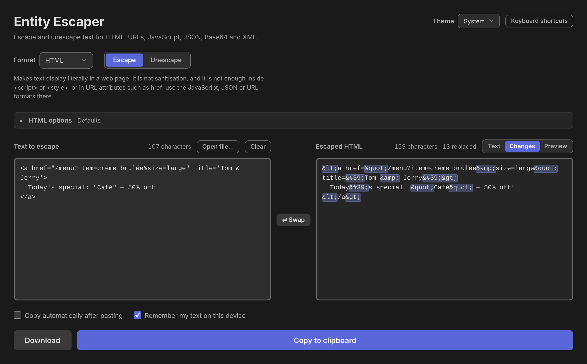

# Entity Escaper

Escape and unescape text for **HTML, URLs, JavaScript strings, JSON strings, Base64 and XML**, in the browser. Paste text, pick a format, copy the result. It runs entirely client-side, with no server and no tracking. It's a static site you can host anywhere or drop into an existing website.

<picture>
  <source media="(prefers-color-scheme: light)" srcset="docs/images/screenshot-light.png" />
  
</picture>

## Features

- **Six formats, both directions.** Escape ⇄ Unescape (or Encode ⇄ Decode), with **Swap** to send the output back the other way.
- **Context-aware HTML options:**
  - escape for element text or for attribute values
  - non-ASCII as numeric or named entities (`&#233;` or `&eacute;`)
  - decimal or hex numeric references, and `&#39;` or `&apos;`
  - line breaks → `<br>`, tabs → spaces, and wrapping in `<pre><code>`
- **Options for the other formats:**
  - URL: component, whole URL, or form data (space as `+`)
  - JavaScript: quote style, and "safe inside `<script>`"
  - JSON: ASCII-only output
  - Base64: URL-safe alphabet, and 76-column wrapping
  - XML: entities or CDATA
- **See what happened:**
  - the **Changes** view highlights every replacement
  - the **Preview** shows HTML rendered, in a sandbox with scripts and network requests blocked
  - character counts, plus how many things were replaced, encoded or decoded
- **Guard rails:**
  - a warning (with one-click fixes) before you double-escape text that's already escaped
  - precise errors for invalid input, such as a bad JSON escape with its position
  - lenient decoding with warnings, for example when a URL contains an invalid UTF-8 byte
- **Comfortable to use:**
  - light and dark themes (following the system, or chosen)
  - side-by-side layout on wide screens
  - keyboard shortcuts, and every action works from the keyboard alone
  - open or drag in a text file, and download the output
  - Clear with Undo
  - remembers your text and settings on your device (the text part can be turned off)
- **Built to be trusted:**
  - strict Content Security Policy, with nothing inline
  - no runtime dependencies besides [`entities`](https://www.npmjs.com/package/entities)
  - 200+ automated tests (unit, integration and end-to-end), including axe accessibility scans in both themes

## Quick start

Requires [Node.js](https://nodejs.org/) 22.12 or later (`.nvmrc` pins 22).

```sh
git clone <your-fork-url> entity-escaper
cd entity-escaper
npm install
npm run dev        # http://localhost:5173
```

`npm run build` writes a static site to `dist/`. Serve that folder from any web server or static host.

## Deploying

The build is plain static files with relative paths, so it works at a domain root or in any sub-folder.

| Host                    | How                                                                                                                                                                               |
| ----------------------- | --------------------------------------------------------------------------------------------------------------------------------------------------------------------------------- |
| **Netlify**             | Import the repo. `netlify.toml` sets the build command, output folder and Node version, and Netlify picks up the generated `dist/_headers`.                                       |
| **Cloudflare Pages**    | Build command `npm run build`, output directory `dist`. `_headers` is supported.                                                                                                  |
| **GitHub Pages**        | Set Settings → Pages → Source to **GitHub Actions**, then run the **Deploy to GitHub Pages** workflow from the Actions tab.                                                       |
| **Vercel**              | Framework preset "Vite", output directory `dist`. Vercel ignores `_headers`; the Content Security Policy still applies through the page's `<meta>` tag.                           |
| **Anything else**       | Upload the contents of `dist/`.                                                                                                                                                   |
| **Inside another site** | Copy `dist/` into a folder of the site, such as `public/tools/entity-escaper/` in Astro. See [docs/embedding.md](docs/embedding.md) for paths, headers and keeping it up to date. |

### Security headers

The build adds a strict **Content Security Policy** to `index.html` as a `<meta>` tag, so it applies on every host. The build also writes **`dist/_headers`** (for Netlify and Cloudflare Pages). It contains the same policy plus `frame-ancestors`, `nosniff`, `Referrer-Policy`, `Permissions-Policy` and long-term caching for the hashed files in `assets/`. Both are generated in `vite.config.js`. That includes the hash that allows the preview frame's stylesheet, so they never go out of date.

## Scripts

| Script                | What it does                                                         |
| --------------------- | -------------------------------------------------------------------- |
| `npm run dev`         | Development server with hot reload                                   |
| `npm run build`       | Production build into `dist/`                                        |
| `npm run preview`     | Serve the production build locally                                   |
| `npm test`            | Unit and integration tests (Vitest, jsdom); `test:watch` to watch    |
| `npm run test:e2e`    | End-to-end and accessibility tests (Playwright and axe) on the build |
| `npm run typecheck`   | Strict type check of the JavaScript, from its JSDoc                  |
| `npm run lint`        | ESLint                                                               |
| `npm run format`      | Prettier (write); `format:check` to verify                           |
| `npm run check`       | Lint, formatting, types, unit tests and build. CI runs this.         |
| `npm run screenshots` | Regenerate the images in `docs/images/`                              |

End-to-end tests need a browser: run `npx playwright install chromium` once, or set `CHROME_PATH` to an installed Chrome.

## Adding a format

Each format is one file in `src/codecs/`.

1. Create `src/codecs/<name>.js` exporting a `Codec` (the contract is in `src/codecs/types.js`):
   - labels for both directions, and one line of guidance
   - option definitions
   - `encode` and `decode` functions that return `{ text, count, ranges }`, optionally with `error` or `warnings`
2. Add it to the list in `src/codecs/index.js`.

That's all. These pick it up automatically:

- the format menu, the options panel and the double-encoding notice
- the views and saved settings
- the contract tests: labels, option validity, and round trips over hundreds of random strings for every option

Use `trackedReplace()` from `src/lib/tracked-replace.js` to get counts and highlight ranges for free. Mark options that make decoding lossy with `lossy: true`. See [CONTRIBUTING.md](CONTRIBUTING.md) for more.

## How it's built

Vanilla JavaScript (ES modules), HTML and CSS, with no framework. [Vite](https://vite.dev/) builds it. The code is typed with JSDoc and checked strictly by TypeScript (`checkJs`), with no compile step.

```
src/
├── main.js / app.js     Entry point; wires the DOM to state (one render(state) function)
├── codecs/              One file per format, plus the registry and the Codec contract
├── lib/                 Pure helpers (escaping, entity detection, tracked replace, clipboard)
├── state/               Tiny store, state shape, localStorage persistence (validated, migrated)
├── ui/                  Options panel, output views, preview, theme, files, shortcuts
└── styles/              tokens.css (all colours, light and dark) → base.css → components.css
tests/                   Vitest unit and DOM tests
e2e/                     Playwright end-to-end and axe accessibility tests
public/                  Copied as-is: favicon, theme-init.js (applies the theme before first paint)
```

## Privacy

Everything happens in your browser. Nothing you type is sent anywhere: the policy even forbids the page from making network requests to other sites. Your text and settings are saved in your browser's `localStorage`, under the key `entity-escaper:v2`, so they're there next time. Untick **Remember my text on this device** to stop storing the text, which also deletes any saved copy.

## Browser support

Built for current versions of Chrome, Edge, Firefox and Safari (2024 and later). The app relies on CSS `light-dark()`, the Popover API and `:has()`. The automated browser tests run in Chromium, on desktop and mobile layouts.

## Contributing and security

Contributions are welcome: see [CONTRIBUTING.md](CONTRIBUTING.md). Please report vulnerabilities privately, as described in [SECURITY.md](SECURITY.md). Plans and ideas are in [ROADMAP.md](ROADMAP.md), and changes in [CHANGELOG.md](CHANGELOG.md).

## License

[MIT](LICENSE). Use it, fork it, and change it for your own projects.
